<p align="center">
  
</p>

# EduConnect: frontend

The React frontend of EduConnect. The same code builds in two ways: an app that talks to the real API, and a live
demo that runs in the browser without any backend.

[](https://github.com/mrfiratatalay/educonnect-backend/blob/main/docs/en/01-story.md)


**[Live demo](https://educonnect-tez.vercel.app)** · **[Backend and documentation](https://github.com/mrfiratatalay/educonnect-backend/blob/main/README.en.md)** ·
**[Türkçe](README.md)**

EduConnect is the graduation project Ayşe Mandıralı and I built in the Computer Engineering department of Recep Tayyip
Erdoğan University, supported by TÜBİTAK 2209-A: a feed, communities, events, a second-hand market, messaging and the
EduAI assistant, which answers questions based on official sources. This repository holds the frontend; the API, the
AI service and all of the project's documentation live in
[educonnect-backend](https://github.com/mrfiratatalay/educonnect-backend).

In November 2026 I found the live site opening empty: Render's free database had expired. I added a demo mode that
replaces the real API at the transport layer. The screen code is identical in both modes, and the demo code never
enters the real build. On the live address you can log in with every role in one click, without a password.

## How to review it

| Time | What to do |
|---|---|
| 1 minute | Open the [live demo](https://educonnect-tez.vercel.app) and click a role card |
| 5 minutes | [Demo tour](https://github.com/mrfiratatalay/educonnect-backend/blob/main/docs/en/02-demo-tour.md): a step-by-step tour with four roles |
| 15 minutes | [Frontend and design](https://github.com/mrfiratatalay/educonnect-backend/blob/main/docs/en/08-frontend-and-design.md) and [Deployment strategy](https://github.com/mrfiratatalay/educonnect-backend/blob/main/docs/en/09-deployment-strategy.md) |
| The real system | Start the backend with `docker compose up --build`, then run `npm run dev` here |

The UI is in Turkish; the demo tour gives the English meaning of every label it uses.

## Screenshots

| Personalized feed | Community |
|---|---|
|  | 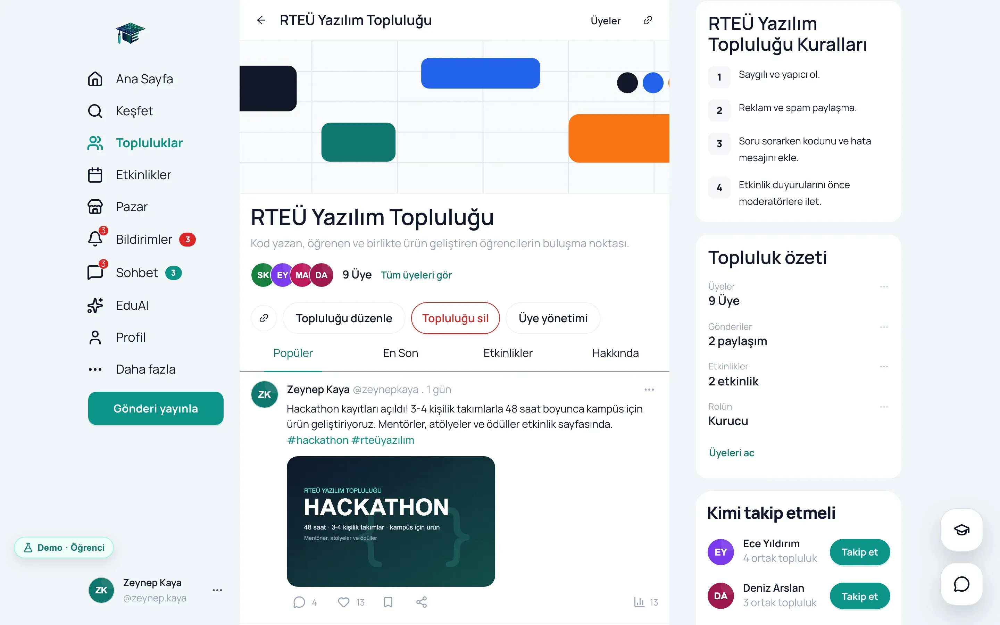 |
| **EduAI, with its source** | **Visual search** |
| 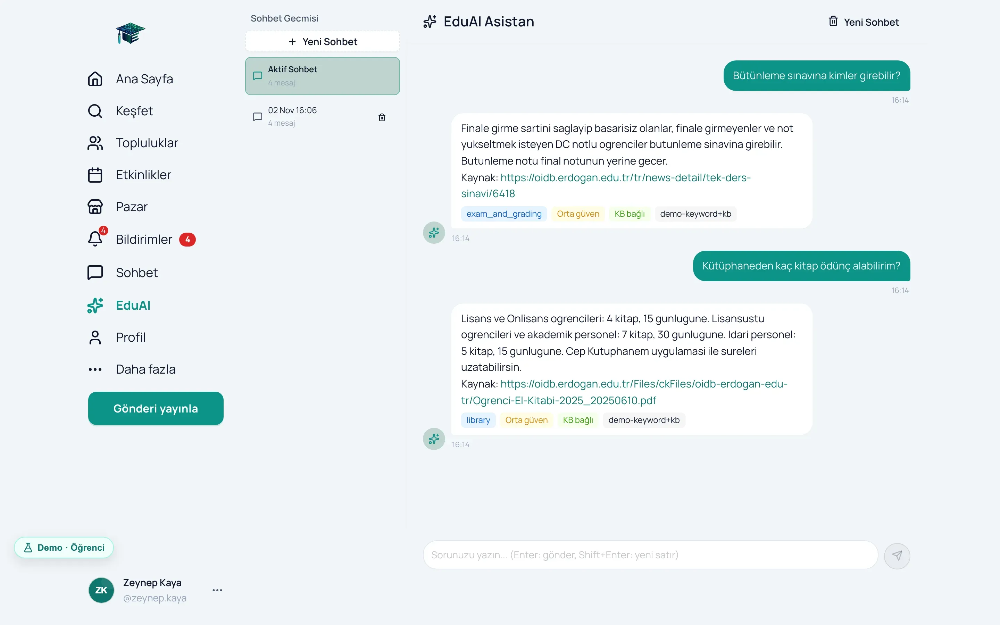 | 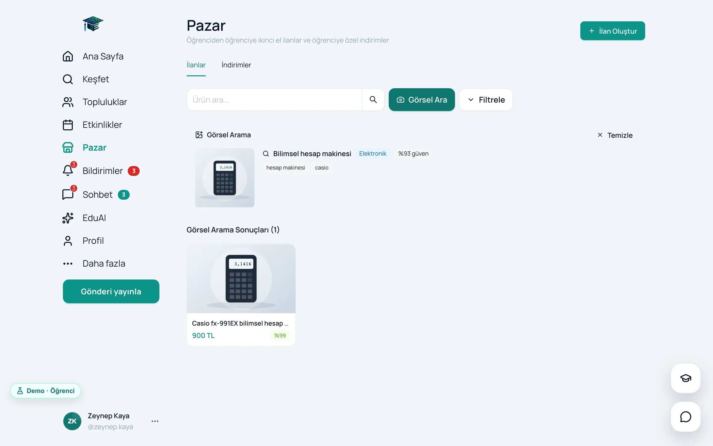 |
| **Events** | **Market** |
| 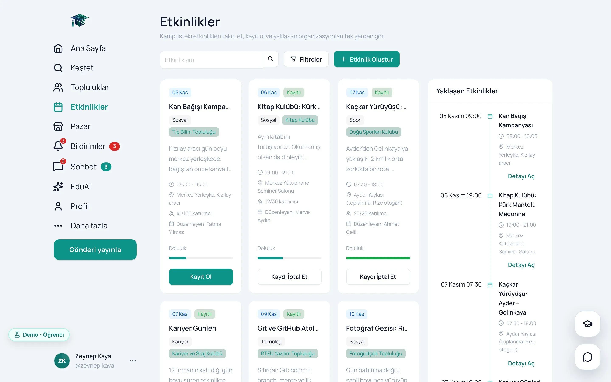 | 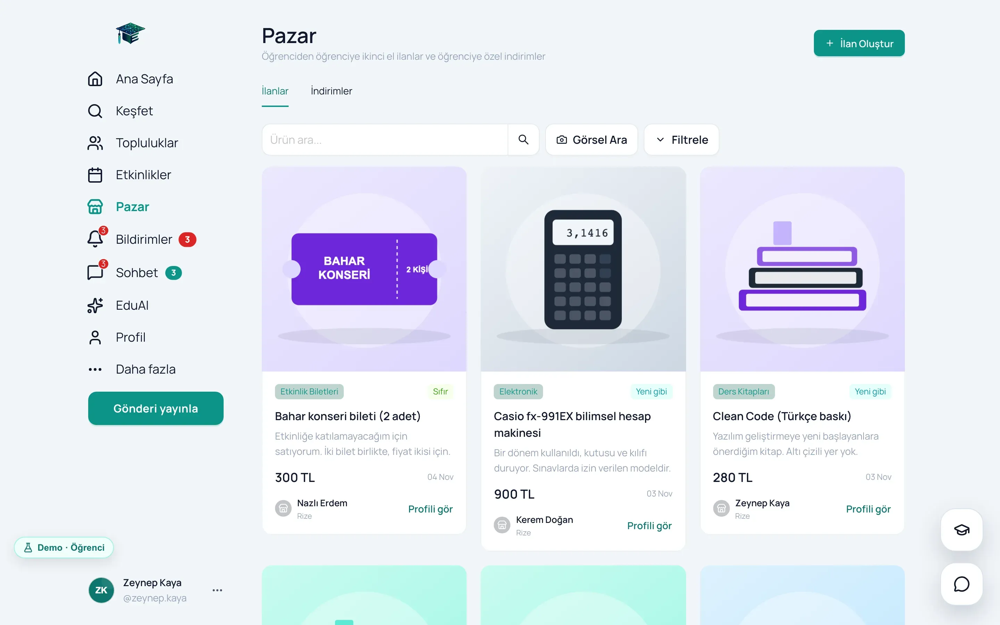 |
| **Messages** | **Profile** |
| 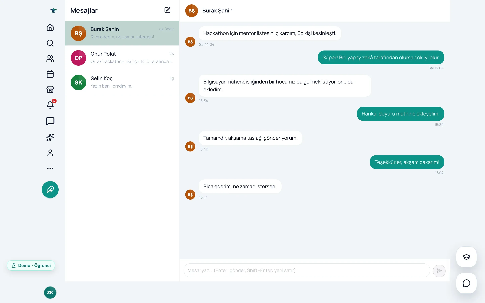 | 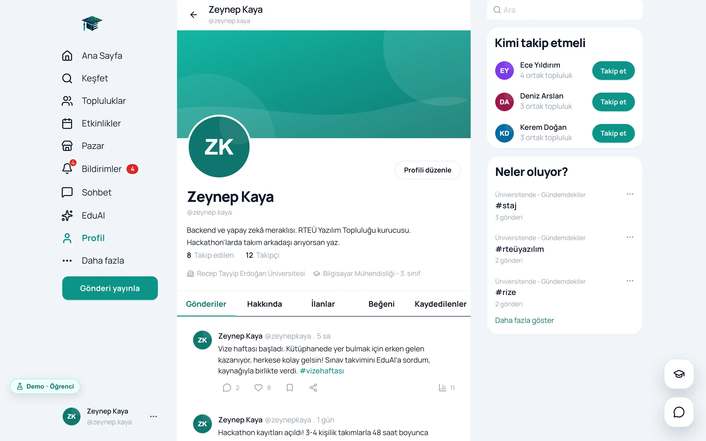 |
| **Dark theme** | **Landing page and role cards** |
| 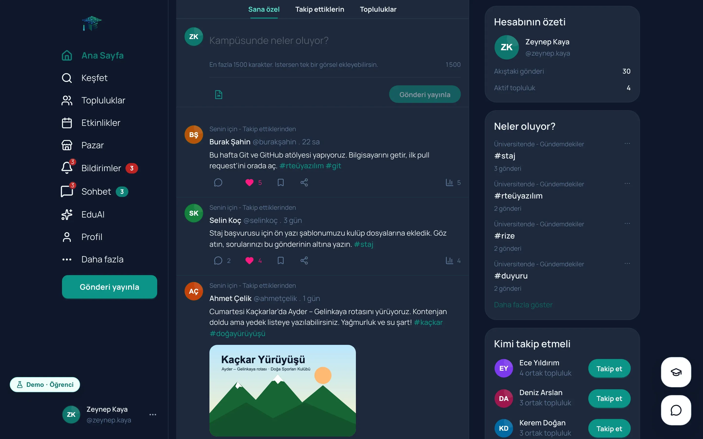 |  |

| Feed on a phone | Community on a phone | EduAI on a phone |
|---|---|---|
| 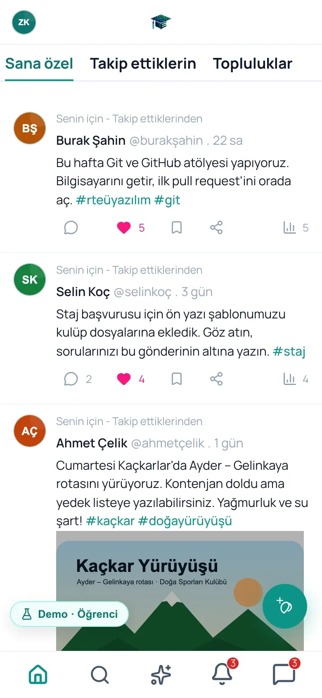 | 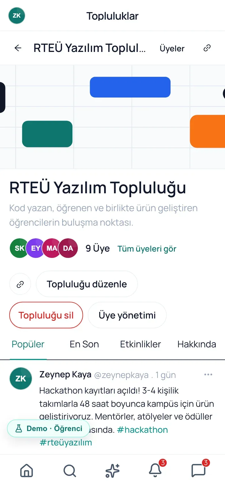 | 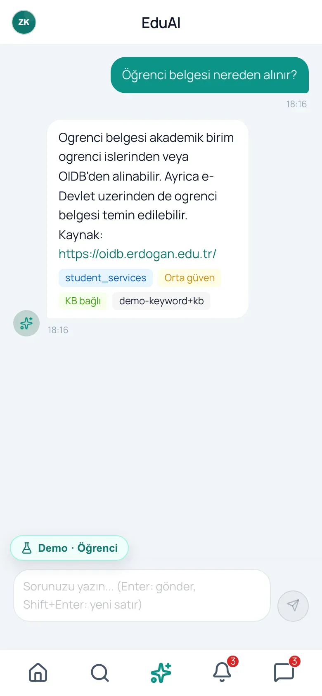 |

## How the demo works

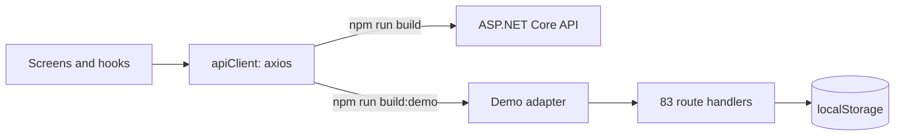

- **The transport layer in one place.** Every module gets its HTTP client from [apiClient.ts](src/lib/apiClient.ts)
  and its realtime connection from [realtime.ts](src/lib/realtime.ts). In the demo build, the axios adapter and the
  SignalR connection are replaced by in-browser counterparts; screens do not know which mode they are running in.
- **The same contract.** The handlers under [src/demo](src/demo) use the real API's paths, field names and error
  codes. Message and notification events arrive with the hubs' event names.
- **Realistic data that never looks stale.** 16 users, 7 communities, 30 posts, 8 events, 13 listings; the names are
  Turkish and made up. Dates are generated relative to the visit and move forward by whole days for returning
  visitors.
- **Reset.** Changes are kept in the browser; the Demo badge lets you switch roles or reset the demo.
- **No trace in the real build.** `__DEMO_MODE__` becomes a constant at build time ([vite.config.ts](vite.config.ts));
  in the real build the demo branches and dynamic imports drop out of the bundle completely.

Details and the cost: [Deployment strategy](https://github.com/mrfiratatalay/educonnect-backend/blob/main/docs/en/09-deployment-strategy.md).

## Commands

| Command | What it does |
|---|---|
| `npm install` | Installs the dependencies |
| `npm run dev` | Dev server (http://localhost:5173); the API defaults to `http://localhost:5160` |
| `npm run dev:demo` | The demo mode without a backend |
| `npm run build` | The real build: type check and `dist/` |
| `npm run build:demo` | The demo build; Vercel uses this one ([vercel.json](vercel.json)) |
| `npm run preview` | Serves the built bundle locally |

To run the real API locally, `docker compose up --build` in the backend repository is enough; the steps are in
[Running and API](https://github.com/mrfiratatalay/educonnect-backend/blob/main/docs/en/10-running-and-api.md). If the
API lives elsewhere, set `VITE_API_BASE_URL`.

## Technologies

| Job | Choice |
|---|---|
| UI | React 19.2, TypeScript 5.9 |
| Build | Vite 8 |
| Components and theme | Ant Design 6.3, lucide-react; every color is in [antdTheme.ts](src/theme/antdTheme.ts) |
| Server data | TanStack Query 5.95: caching, infinite scroll, optimistic updates |
| App state | Zustand 5 |
| Routing | React Router 6.30 |
| HTTP and real time | axios 1.13, @microsoft/signalr 10 |
| Forms | React Hook Form 7.72, zod 4.3 |
| EduAI answers | react-markdown, remark-gfm |

## Project structure

```
src/
├── pages/        22 page files; 23 routes in App.tsx
├── features/     11 modules: requests (api.ts) and query hooks (hooks.ts)
├── components/   the app shell, mobile navigation, the EduAI panel, shared components
├── store/        5 Zustand stores: session, theme, UI, chat, post composer
├── lib/          apiClient.ts, realtime.ts, signalrLifecycle.ts
├── theme/        antdTheme.ts
└── demo/         the in-browser demo backend; only part of the demo build
```

## Frontend highlights

- **The access token lives only in memory.** On startup the session comes back through the HttpOnly cookie, and
  expired requests share a single refresh call ([authenticatedRequest.ts](src/features/auth/authenticatedRequest.ts)).
- **Optimistic updates.** Likes, bookmarks, follows and messages appear without waiting for the server; on an error
  the cache is rolled back ([posts/hooks.ts](src/features/posts/hooks.ts)).
- **Light and dark themes.** The "deep teal" design language; the choice is kept in the browser.
- **Mobile.** A bottom navigation bar, a drawer menu and a floating compose button on phones.
- **Honest limits.** Routes are not lazy-loaded, and the real build's main bundle is 2,157 KB (639 KB gzipped); no
  accessibility audit has been done. Details in
  [Frontend and design](https://github.com/mrfiratatalay/educonnect-backend/blob/main/docs/en/08-frontend-and-design.md).

## Team

**Fırat Atalay** and **Ayşe Mandıralı** built EduConnect together. We shared every responsibility; there was no
captain or single owner. A large part of the code was written together with AI coding assistants (Claude Code); we
decided the architecture, the rules and what counted as correct. We thank the TÜBİTAK 2209-A programme for its
support.

**Notice.** Recep Tayyip Erdoğan University, TÜBİTAK and other names are trademarks of their owners. EduConnect is a
student project, not an official service of the university. The people and data in the demo are made up.
