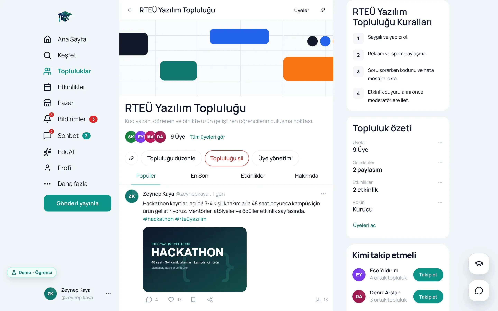
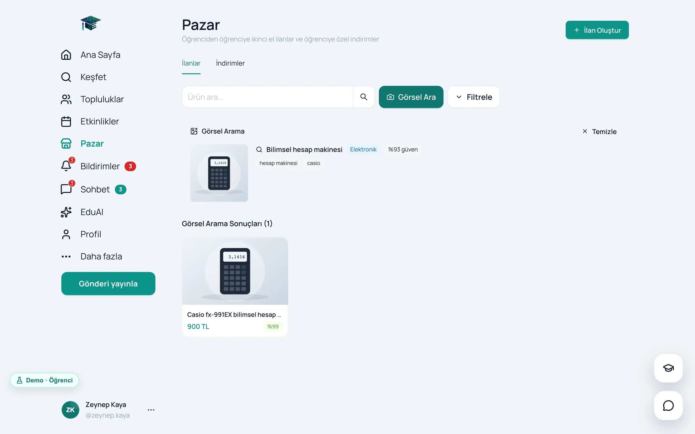
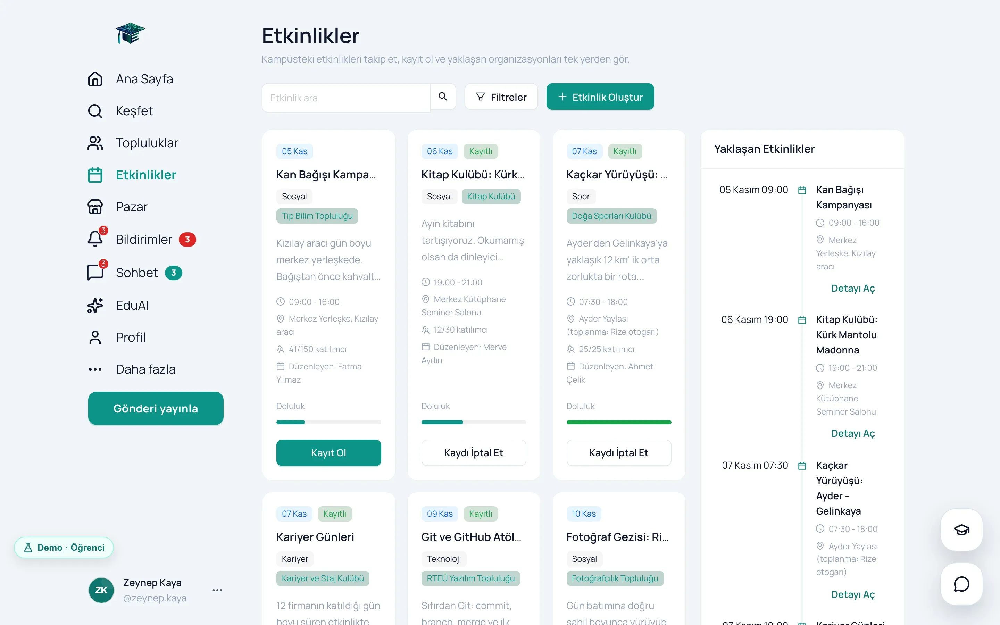
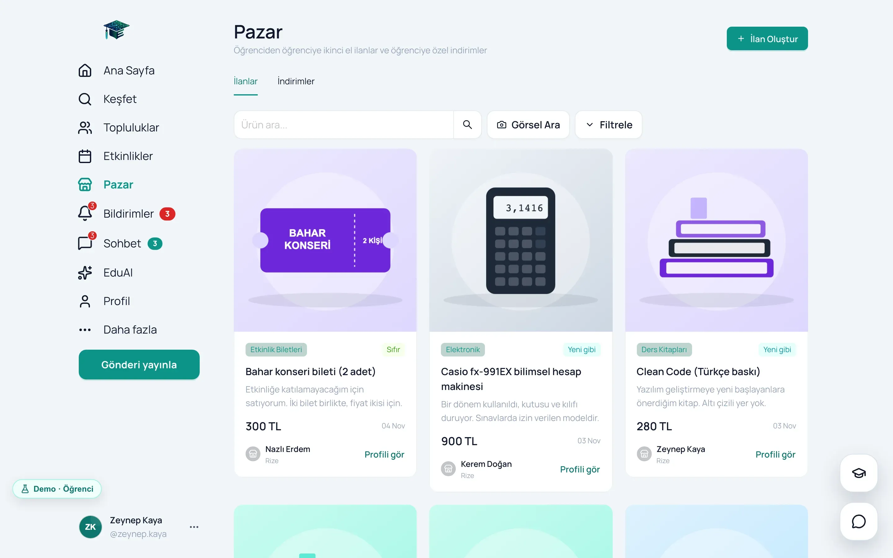
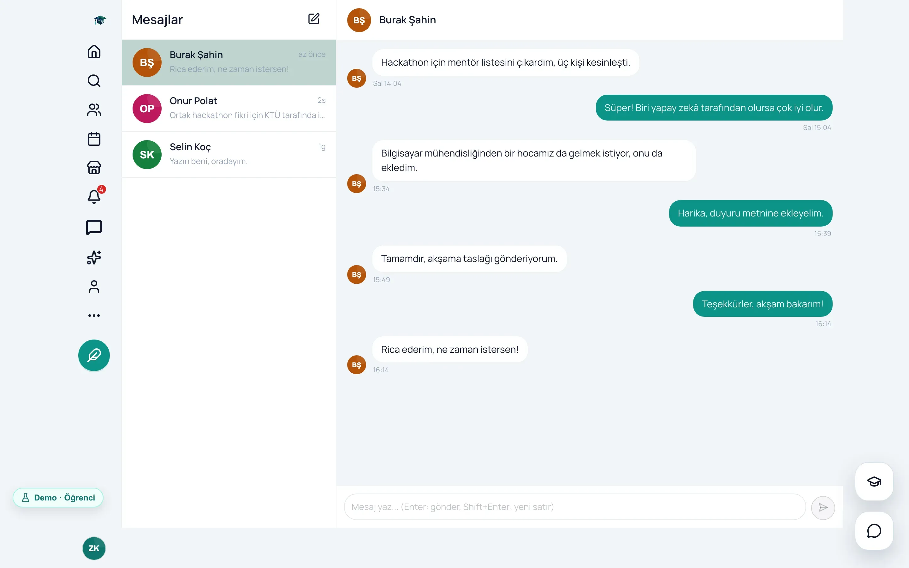
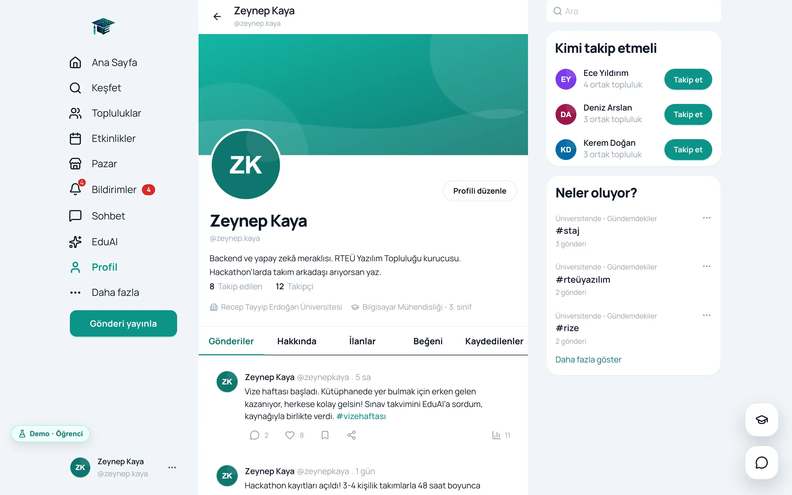
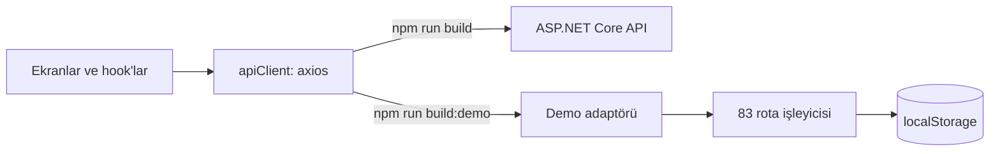

<p align="center">
  
</p>

# EduConnect: arayüz

EduConnect'in React arayüzü. Aynı kod iki biçimde derleniyor: gerçek API'ye bağlanan uygulama ve hiç backend
gerektirmeden tarayıcıda çalışan canlı demo.

[](https://github.com/mrfiratatalay/educonnect-backend/blob/main/docs/01-hikaye.md)


**[Canlı demo](https://educonnect-tez.vercel.app)** · **[Backend ve dokümanlar](https://github.com/mrfiratatalay/educonnect-backend)** ·
**[English](README.en.md)**

EduConnect, Recep Tayyip Erdoğan Üniversitesi Bilgisayar Mühendisliği bölümünde Ayşe Mandıralı ile birlikte
geliştirdiğimiz, TÜBİTAK 2209-A destekli bitirme projemiz: akış, topluluklar, etkinlikler, ikinci el pazar, mesajlaşma
ve resmî kaynaklara dayanarak cevap veren EduAI asistanı. Bu repo arayüzü içeriyor; API, yapay zekâ servisi ve
projenin bütün dokümanları [educonnect-backend](https://github.com/mrfiratatalay/educonnect-backend) reposunda.

Kasım 2026'da canlı sitenin boş açıldığını gördüm: Render'daki ücretsiz veritabanının süresi dolmuştu. Arayüze,
taşıma katmanında gerçek API'nin yerine geçen bir demo modu ekledim. Ekranların kodu iki modda da aynı; demo kodu
gerçek derlemeye hiç girmiyor. Canlı adreste her rolle tek tıkla, şifresiz giriş yapılıyor.

## Nasıl incelersin?

| Süre | Ne yapmalı? |
|---|---|
| 1 dakika | [Canlı demoyu](https://educonnect-tez.vercel.app) aç ve bir rol kartına tıkla |
| 5 dakika | [Demo turu](https://github.com/mrfiratatalay/educonnect-backend/blob/main/docs/02-demo-turu.md): dört rolle adım adım bir tur |
| 15 dakika | [Arayüz ve tasarım](https://github.com/mrfiratatalay/educonnect-backend/blob/main/docs/08-arayuz-ve-tasarim.md) ve [Yayın stratejisi](https://github.com/mrfiratatalay/educonnect-backend/blob/main/docs/09-yayin-stratejisi.md) |
| Gerçek sistem | Backend'i `docker compose up --build` ile aç, sonra burada `npm run dev` |

## Ekran görüntüleri

| Kişiselleştirilmiş akış | Topluluk |
|---|---|
|  |  |
| **EduAI, kaynağıyla** | **Görsel arama** |
|  |  |
| **Etkinlikler** | **Pazar** |
|  |  |
| **Mesajlar** | **Profil** |
|  |  |
| **Koyu tema** | **Giriş ve rol kartları** |
|  |  |

| Telefonda akış | Telefonda topluluk | Telefonda EduAI |
|---|---|---|
|  |  |  |

## Demo nasıl çalışıyor?



- **Taşıma katmanı tek yerde.** Bütün modüller HTTP istemcisini [apiClient.ts](src/lib/apiClient.ts)'den, anlık
  bağlantıyı [realtime.ts](src/lib/realtime.ts)'ten alıyor. Demo derlemesinde axios'un adaptörü ve SignalR bağlantısı
  tarayıcı içindeki karşılıklarıyla değişiyor; ekranlar hangi modda çalıştıklarını bilmiyor.
- **Aynı sözleşme.** [src/demo](src/demo) altındaki işleyiciler gerçek API'nin adreslerini, alan adlarını ve hata
  kodlarını kullanıyor. Mesaj ve bildirim olayları hub'lardaki adlarla geliyor.
- **Gerçekçi ve hiç eskimeyen veri.** 16 kullanıcı, 7 topluluk, 30 gönderi, 8 etkinlik, 13 ilan; isimler Türkçe ve
  uydurma. Tarihler açılış anına göre üretiliyor, geri gelen ziyaretçide tam gün kadar ileri kaydırılıyor.
- **Sıfırlama.** Değişiklikler tarayıcıda saklanıyor; Demo rozetinden rol değiştirilebiliyor ya da demo sıfırlanıyor.
- **Gerçek derlemede iz yok.** `__DEMO_MODE__` derleme sırasında sabite dönüşüyor ([vite.config.ts](vite.config.ts));
  gerçek derlemede demo dalları ve dinamik içe aktarmalar paketten tamamen çıkıyor.

Ayrıntısı ve bedeli: [Yayın stratejisi](https://github.com/mrfiratatalay/educonnect-backend/blob/main/docs/09-yayin-stratejisi.md).

## Komutlar

| Komut | Ne yapıyor? |
|---|---|
| `npm install` | Bağımlılıkları kuruyor |
| `npm run dev` | Geliştirme sunucusu (http://localhost:5173); API varsayılan olarak `http://localhost:5160` |
| `npm run dev:demo` | Backend'siz demo modu |
| `npm run build` | Gerçek derleme: tip kontrolü ve `dist/` |
| `npm run build:demo` | Demo derlemesi; Vercel bunu kullanıyor ([vercel.json](vercel.json)) |
| `npm run preview` | Derlenmiş paketi yerelde açıyor |

Gerçek API'yi yerelde çalıştırmak için backend reposunda `docker compose up --build` yeterli; adımlar
[Çalıştırma ve API](https://github.com/mrfiratatalay/educonnect-backend/blob/main/docs/10-calistirma-ve-api.md)
dokümanında. API başka bir adresteyse `VITE_API_BASE_URL` ile değiştirilebiliyor.

## Teknolojiler

| İş | Seçim |
|---|---|
| Arayüz | React 19.2, TypeScript 5.9 |
| Derleme | Vite 8 |
| Bileşenler ve tema | Ant Design 6.3, lucide-react; bütün renkler [antdTheme.ts](src/theme/antdTheme.ts) içinde |
| Sunucu verisi | TanStack Query 5.95: önbellek, sonsuz kaydırma, iyimser güncelleme |
| Uygulama durumu | Zustand 5 |
| Yönlendirme | React Router 6.30 |
| HTTP ve anlık iletişim | axios 1.13, @microsoft/signalr 10 |
| Formlar | React Hook Form 7.72, zod 4.3 |
| EduAI cevapları | react-markdown, remark-gfm |

## Proje yapısı

```
src/
├── pages/        22 sayfa dosyası; 23 rota App.tsx içinde
├── features/     11 modül: istekler (api.ts) ve sorgu hook'ları (hooks.ts)
├── components/   uygulama kabuğu, mobil gezinme, EduAI paneli, ortak bileşenler
├── store/        5 Zustand deposu: oturum, tema, arayüz, sohbet, gönderi yazma
├── lib/          apiClient.ts, realtime.ts, signalrLifecycle.ts
├── theme/        antdTheme.ts
└── demo/         tarayıcıda çalışan demo backend'i; yalnızca demo derlemesine giriyor
```

## Arayüz tarafında öne çıkanlar

- **Access token yalnızca bellekte.** Açılışta oturum HttpOnly çerezle geri geliyor; süresi dolan istekler tek bir
  refresh çağrısını paylaşıyor ([authenticatedRequest.ts](src/features/auth/authenticatedRequest.ts)).
- **İyimser güncelleme.** Beğeni, kaydetme, takip ve mesajlar sunucuyu beklemeden görünüyor; hata olursa önbellek
  geri alınıyor ([posts/hooks.ts](src/features/posts/hooks.ts)).
- **Açık ve koyu tema.** "Derin turkuaz" tasarım dili; tercih tarayıcıda saklanıyor.
- **Mobil.** Telefonda alt gezinme çubuğu, açılır menü ve yüzen gönderi yazma düğmesi.
- **Dürüst sınırlar.** Rotalar tembel yüklenmiyor, gerçek derlemenin ana paketi 2.157 KB (gzip 639 KB); erişilebilirlik
  denetimi yapılmadı. Ayrıntısı
  [Arayüz ve tasarım](https://github.com/mrfiratatalay/educonnect-backend/blob/main/docs/08-arayuz-ve-tasarim.md)
  dokümanında.

## Ekip

EduConnect'i **Fırat Atalay** ve **Ayşe Mandıralı** birlikte geliştirdi. Bütün sorumlulukları paylaştık; kaptan ya
da tek bir sahip yoktu. Kodun önemli bir kısmı yapay zekâ kodlama asistanlarıyla (Claude Code) birlikte yazıldı;
mimariyi, kuralları ve doğruluğu biz belirledik. Desteği için TÜBİTAK 2209-A programına teşekkür ederiz.

**Uyarı.** Recep Tayyip Erdoğan Üniversitesi, TÜBİTAK ve diğer adlar sahiplerinin markalarıdır. EduConnect bir
öğrenci projesi; üniversitenin resmî bir hizmeti değil. Demodaki kişiler ve veriler uydurma.
